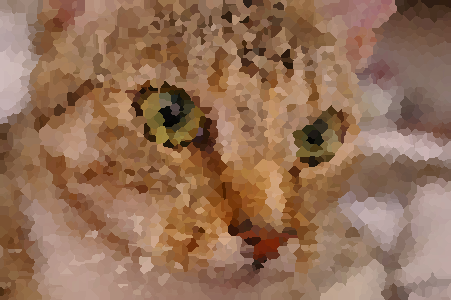
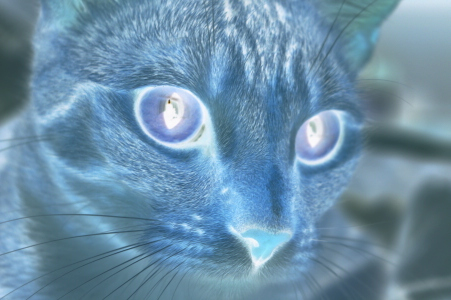
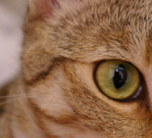
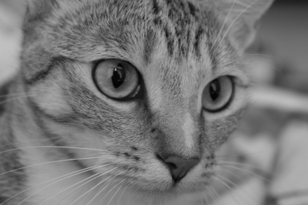
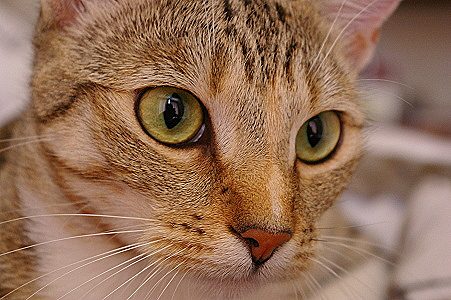
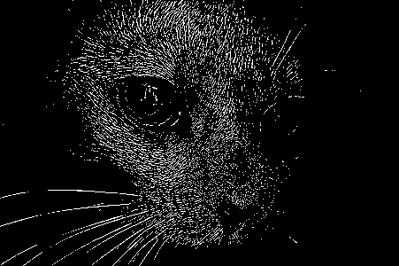

# Image Processor

A command-line tool written in C++23 that applies a chain of filters to BMP images. It ships with a hand-written BMP parser, an extensible filter architecture and unit tests in Catch2.

<p align="center">
  
  
  
  
</p>

## Features

- Reads and writes 24-bit BMP files without third-party libraries
- 7 filters that can be chained in any order and any number
- Clear error messages for invalid arguments and unsupported file formats
- CMake build, CTest test runner, optional AddressSanitizer and UBSan build

## Building

Requirements: CMake 3.20+ and a C++23 compiler (tested with GCC 13).

```bash
git clone https://github.com/cot-in/image_processor.git
cd image_processor
cmake -S . -B build
cmake --build build -j
```

The binary is placed at `build/image_processor`.

## Usage

```bash
./build/image_processor <input.bmp> <output.bmp> [-<filter> [param ...]] ...
```

Filters are applied one after another, from left to right. Running the program without arguments prints help.

Examples:

```bash
./build/image_processor cat.bmp out.bmp -gs
./build/image_processor cat.bmp out.bmp -blur 3
./build/image_processor cat.bmp out.bmp -crop 800 600 -gs -edge 0.1
```

## Filters

| Filter | Arguments | Result |
|---|---|---|
| Original image | |  |
| `-crop width height` | positive integers |  |
| `-gs` | — |  |
| `-neg` | — |  |
| `-sharp` | — |  |
| `-edge threshold` | threshold from 0 to 1 |  |
| `-blur sigma` | positive number |  |
| `-crystal count` | positive integer |  |

The images were produced with `-crop 220 200`, `-edge 0.1`, `-blur 3` and `-crystal 3000`.

### How the filters work

**Crop.** Keeps the top-left region of the given size. If the requested size is larger than the image, that dimension is left unchanged.

**Grayscale.** Replaces every pixel with its luma `0.299·R + 0.587·G + 0.114·B` (ITU-R BT.601 coefficients).

**Negative.** Replaces every channel with `1 − C`.

**Sharpening and Edge Detection.** Convolution with a 3×3 kernel. Pixels outside the image are replaced with the nearest edge pixel.

```
Sharpening        Edge Detection
 0 -1  0           0 -1  0
-1  5 -1          -1  4 -1
 0 -1  0           0 -1  0
```

Edge Detection first converts the image to grayscale. After the convolution, a pixel becomes white if its value exceeds `threshold` and black otherwise.

**Gaussian Blur.** The Gaussian kernel is separable, so instead of one 2D convolution the filter runs two 1D passes, over rows and over columns. The kernel length is about `6σ`, which gives `O(W·H·σ)` time instead of `O(W·H·σ²)`.

**Crystallize.** Picks `count` random pixels as seeds. A multi-source BFS then assigns every pixel to its nearest seed by Manhattan distance, and the pixel takes the seed's color. The result is a Voronoi diagram in the L1 metric, computed in `O(W·H)`.

## Architecture

```
argv ──► Parser ──► Controller ──► factories ──► filters ──► WriteImage
                        ▲
             ReadImage ─┘
```

| Component | Files | Responsibility |
|---|---|---|
| Parser | `parser.h/.cpp` | Turns command-line arguments into a list of `{filter name, parameters}` |
| IO | `io.h/.cpp` | Reads and writes BMP files, validates headers, handles 4-byte row padding |
| Image | `image.h/.cpp` | Stores pixels; channels are `double` values in `[0, 1]` |
| Factories | `fabrics/` | Validate parameters and create a filter by name |
| Filters | `filters/` | Common interface `BaseFilter::Apply(Image&)`; convolution filters derive from `BaseFilterWithMatrix` |
| Controller | `controller.h/.cpp` | Name-to-factory registry; builds and applies the filter chain |
| Errors | `exceptions.h/.cpp` | Exception hierarchy rooted at `ImageProcessorException` |

### Adding a new filter

1. Create a class in `filters/` derived from `BaseFilter`, or from `BaseFilterWithMatrix` if the filter is a convolution kernel.
2. Create a factory in `fabrics/` that validates the parameters and returns a filter instance.
3. Register the factory under its command-line name in `controller.h`.
4. Add the new `.cpp` files to `image_processor_lib` in `CMakeLists.txt`.

## Testing

```bash
ctest --test-dir build --output-on-failure
```

Tests live in `tests/` and cover argument parsing, the `Image` class and parameter validation for every filter. Catch2 is downloaded automatically with `FetchContent`; pass `-DIMAGE_PROCESSOR_BUILD_TESTS=OFF` to skip building the tests.

Building with sanitizers:

```bash
cmake -S . -B build-asan -DCMAKE_BUILD_TYPE=Debug -DIMAGE_PROCESSOR_SANITIZE=ON
cmake --build build-asan -j
ctest --test-dir build-asan --output-on-failure
```

## Image format

Supported: BMP with a `BITMAPINFOHEADER`, 24 bits per pixel, no compression and no color table. Both bottom-up and top-down (negative height) row order are accepted.


To convert an image with ImageMagick:

```bash
convert input.jpg -alpha off -type TrueColor BMP3:output.bmp
```

## Image credits

The cat photo is `chelsea.png` from the [scikit-image](https://github.com/scikit-image/scikit-image) sample data, released under CC0.
